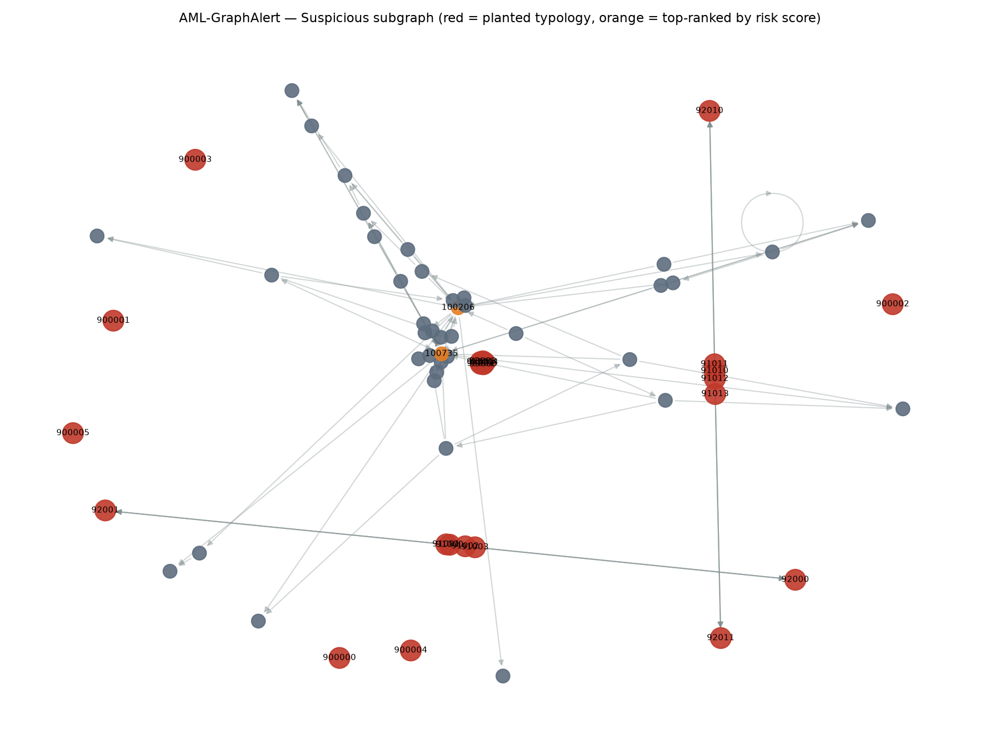

# AML-GraphAlert — Detección de tipologías de PLD y redes de transacciones

[](https://www.python.org/)
[](sql/README_SQL.md)
[](https://networkx.org/)
[](LICENSE)

[Read the English version](README.md)

---

## Qué hace

Los bancos y las fintechs deben detectar *operaciones inusuales* — actividad
que no coincide con el perfil de un cliente o que encaja en tipologías
conocidas de lavado de dinero — y reportarlas. Los motores de reglas por sí
solos generan demasiadas alertas: la mayoría son falsos positivos y los
analistas se saturan. Este proyecto combina tres capas, en el orden en que
un equipo de cumplimiento las usaría en la práctica:

| Capa | Herramienta | Qué detecta |
|---|---|---|
| **1. Reglas SQL** | DuckDB / PostgreSQL (`sql/`) | Pitufeo, desviación del perfil, fan-in/fan-out |
| **2. Análisis de grafos** | NetworkX (`src/graph_analysis.py`) | Ciclos cerrados (round-tripping), anillos de mulas, cuentas colectoras, nodos puente (PageRank / betweenness) |
| **3. Priorización de alertas** | Isolation Forest (`src/alert_scoring.py`) | Ordena las cuentas marcadas de 0 a 100 para revisar primero las de mayor riesgo |

El pipeline es totalmente reproducible: `python -m src.run_pipeline`
genera los datos sintéticos, ejecuta el SQL, construye el grafo, puntúa las
alertas y escribe todo en `outputs/`.

## Resultados con el ejemplo sintético — ilustrativos

> ⚠️ **Todos los números siguientes son ilustrativos.** Se calculan sobre
> datos sintéticos con tipologías plantadas (semilla 42), así que muestran
> que el pipeline funciona de principio a fin, no cómo se comportaría con
> datos reales. La precisión y el recall se miden contra las etiquetas
> plantadas, que los equipos reales de cumplimiento no tienen para la
> mayoría de las alertas.

| Métrica | Valor |
|---|---|
| Cuentas / transacciones | 823 / 50,362 (90 días, ene–mar 2026) |
| Cuentas sospechosas plantadas | 23 (6 de pitufeo, 8 mulas, 4 colectoras, 5 de round-tripping) |
| Cuentas con ≥1 regla activada | 25 |
| Filas de reglas activadas (todas las reglas) | 25 (6 pitufeo, 8 fan-in/out, 2 desviación de perfil, 5 ciclo, 4 colectora) |
| Ciclos encontrados (longitud ≤ 6) | 1 — exactamente el ciclo plantado de 5 cuentas |
| Cuentas colectoras detectadas | 4 — todas las colectoras plantadas (`CTA-920xx`), cada una recibiendo de 4 mulas marcadas |
| Precisión / recall, todas las alertas de reglas | **0.920 / 1.000** (23 de 23 plantadas encontradas) |
| Precisión @ top-10 del ranking | 1.000 (10/10) |
| Precisión @ top-21 del ranking | 1.000, recall 0.913 (21/23) |
| Precisión @ top-23 del ranking | 1.000, recall 1.000 (23/23) |
| Precisión @ top-50 del ranking | 0.460, recall 1.000 |



El subgrafo sospechoso (rojo = cuentas con tipología plantada, naranja =
mejor rankeadas por puntaje de riesgo) también está disponible como página
interactiva en `outputs/suspicious_subgraph.html` (ábrelo en un navegador).

### Cómo leer la comparación de falsos positivos

Dos comparaciones, ambas ilustrativas:

1. **El ajuste de reglas le ganó al modelo.** La primera versión de la
   regla de fan-in/out agregaba los 90 días completos: 144 aciertos, y
   todas las alertas de reglas juntas tenían precisión **0.09** /
   recall 0.609. Cambiar la regla a una ventana *semanal* (muchos
   remitentes en una semana, no en tres meses) redujo el fan-in/out a
   **8 aciertos — las 8 mulas** — y todas las alertas de reglas a
   precisión **0.920** / recall 1.000. La elección de la ventana hizo la
   mayor parte del trabajo. Advertencia honesta: los umbrales v2 se
   ajustaron después de ver v1, así que la precisión v2 es optimista;
   con datos reales, los umbrales deben ajustarse con historial
   etiquetado, no con el conjunto que se mide.
2. **El ranking como triaje.** El puntaje de ML ordena las 23 cuentas
   plantadas en las posiciones 1–23 (precisión top-10 1.000, top-23
   1.000). Revisar las 23 cuentas mejor rankeadas en lugar de las 823
   es una **cola de revisión 97.2% menor** con 100% de recall de las
   cuentas plantadas. Las 4 cuentas colectoras quedan en las posiciones
   12–15 (puntaje de riesgo ≈ 62): se detectan con la regla de
   colectoras, que marca cuentas que reciben transferencias SPEI de al
   menos 2 cuentas mula ya marcadas
   (`src/graph_analysis.py: detect_collectors`).

El punto no es el porcentaje exacto (es un artefacto de los datos
sintéticos); el punto es el *flujo de trabajo*: reglas para
explicabilidad y auditoría, ML para el triaje y un humano para la
decisión final. En producción, la misma comparación debe repetirse con
historial etiquetado, con umbrales ajustados a la capacidad y al apetito
de riesgo del equipo.

## Arquitectura

```
data/synthetic/ ──► reglas SQL (DuckDB) ──┐
  accounts.csv      01_structuring.sql   │
  transactions.csv  02_profile_deviation │
  ground_truth.csv  03_fan_in_out.sql    ▼
                     ┌─────────────────────────────────┐
                     │ rule_hits.csv                   │
                     └──────────────┬──────────────────┘
                                    │
  transactions.csv ──► grafo NetworkX ──► ciclos, fan-in/out,
                                           colectoras, PageRank,
                                           betweenness
                                    │
                                    ▼
              IsolationForest + evidencia de reglas
                         │
                         ▼
        outputs/alerts_ranked.csv (risk_score 0–100)
        outputs/metrics.json
        outputs/suspicious_subgraph.html  (interactivo, pyvis)
        outputs/suspicious_subgraph.png
```

## Cómo ejecutar

```bash
git clone https://github.com/carlosedurampz-sketch/AML-GraphAlert.git
cd AML-GraphAlert

python3 -m venv .venv
.venv/bin/pip install -r requirements.txt

# Pipeline completo (genera datos, ejecuta SQL + grafos + ML, escribe outputs/)
.venv/bin/python -m src.run_pipeline

# …o todo, incluidas las pruebas:
bash run_all.sh
# …o:  make run   /   make test
```

Salidas:

| Archivo | Contenido |
|---|---|
| `outputs/alerts_ranked.csv` | Una fila por cuenta, `risk_score` 0–100, `rank`, conteo de reglas, variables de grafo |
| `outputs/rule_hits.csv` | Cada acierto de reglas SQL/grafo (`account_id, rule, detail`) |
| `outputs/collectors.csv` | Cuentas colectoras: mulas remitentes marcadas, montos recibidos |
| `outputs/cycles.csv` | Ciclos cerrados de transferencias encontrados |
| `outputs/fan_in_out.csv` | Fan-in/out y razón de pass-through por cuenta |
| `outputs/centrality.csv` | PageRank y betweenness por cuenta |
| `outputs/metrics.json` | Conteos, precisión/recall (ilustrativos), comparación de reducción de falsos positivos |
| `outputs/suspicious_subgraph.html` | Subgrafo sospechoso interactivo (ábrelo en un navegador) |
| `outputs/suspicious_subgraph.png` | El mismo subgrafo como imagen estática |

### Pruebas

```bash
.venv/bin/python -m pytest tests/ -v
```

Las pruebas ejecutan el SQL real de pitufeo en DuckDB y las funciones
reales de grafos con datos de juguete (detección de ciclos, conteo de
fan-in, detección de colectoras). La CI ejecuta la misma suite en cada
push (`.github/workflows/ci.yml`, Python 3.11 en `ubuntu-latest`).

## Tipologías documentadas

Consulta [`sql/README_SQL.md`](sql/README_SQL.md) para la documentación
completa de cada regla, sus umbrales y sus advertencias. Resumen:

1. **Pitufeo / structuring** (`sql/01_structuring.sql`) — varios depósitos
   en efectivo de MXN 13,500–14,900 (justo por debajo del umbral
   ilustrativo de MXN 15,000) en ventanas de 24 h–7 d, con funciones de
   ventana y marco `RANGE` temporal.
2. **Desviación del perfil** (`sql/02_profile_deviation.sql`) — actividad
   reciente de 7 días muy por encima de la línea base *propia* de la
   cuenta (z-score > 3 o >5× la media, con piso de materialidad y
   requisito de historial mínimo).
3. **Fan-in / fan-out** (`sql/03_fan_in_out.sql`) — muchos remitentes
   SPEI distintos, reenviando casi todo lo recibido
   (`pass_through_ratio ≥ 0.70`), la forma clásica de una cuenta mula.
4. **Round-tripping** (grafo, no SQL) — ciclos cerrados
   A → B → C → D → E → A con montos similares, encontrados con
   `networkx.simple_cycles` sobre componentes fuertemente conexas.
5. **Cuentas colectoras** (grafo, `detect_collectors`) — una cuenta que
   recibe transferencias SPEI de al menos 2 cuentas distintas ya marcadas
   como mulas por la regla de fan-in/out. Las colectoras rara vez reenvían
   fondos, así que las demás reglas no las detectan; las marcas de mula
   son la evidencia que apunta hacia ellas. Umbral:
   `min_distinct_mules = 2`.

Los umbrales son decisiones de modelado para este portafolio, **no**
afirmaciones de la ley mexicana (la LFPIORPI y las reglas de CNBV / UIF
tienen las suyas). Consulta `sql/README_SQL.md` antes de reutilizar
cualquier número.

## Metodología

- **Datos sintéticos, etiquetados por construcción.** Los datos reales de
  PLD son confidenciales, así que el generador
  (`src/generate_synthetic.py`, semilla 42) crea ~800 cuentas normales
  (nómina, SPEI, ATM, tarjeta) y planta 23 sospechosas con las tipologías
  anteriores + un ciclo. Las etiquetas se usan *solo* para evaluación,
  nunca para entrenar el puntaje: el Isolation Forest no es supervisado,
  como en un entorno real donde los casos confirmados son escasos.
- **Sin fuga temporal en las reglas.** La línea base de desviación del
  perfil excluye la ventana reciente con la que se compara; las ventanas
  de pitufeo se deslizan en el tiempo.
- **Explicabilidad antes que cajas negras.** Cada alerta conserva su regla
  (columna `detail`) y sus variables de grafo, para que un analista pueda
  decir *por qué* se marcó una cuenta. El puntaje de ML solo ordena la
  cola.
- **Reproducibilidad.** Semilla fija, dependencias fijadas, un solo comando
  (`bash run_all.sh`) desde un checkout limpio hasta todas las salidas.

## Limitaciones

- Los datos sintéticos son más limpios que los reales: las tipologías están
  plantadas, así que la precisión y el recall son optimistas y no
  comparables con producción. Los umbrales v2 también se ajustaron después
  de ver los resultados v1.
- El grafo se construye solo con transferencias SPEI; el efectivo no tiene
  contraparte.
- El betweenness se muestrea (100 pivotes) por velocidad; el PageRank es
  exacto.
- La detección de ciclos en grafos grandes solo busca aristas agregadas
  ≥ MXN 10,000 (ver `src/graph_analysis.py`): el tráfico aleatorio de bajo
  valor crea incontables ciclos cortos espurios, y un anillo de
  round-tripping mueve montos grandes y repetidos. Los ciclos de bajo valor
  no se detectarían.
- La regla de colectoras depende de la regla de mulas: si una mula no es
  marcada por fan-in/out, tampoco puede apuntar a su colectora.
- Las cuentas que solo aparecen como contraparte (como las colectoras) no
  tienen variables conductuales del lado de las transacciones; se puntúan
  con su evidencia de reglas y sus variables de grafo.
- El puntaje no es supervisado: con casos reales etiquetados, un modelo
  supervisado y calibración serían el siguiente paso.
- Esto es un proyecto de portafolio, no un sistema de cumplimiento: no
  implementa reportes, gestión de casos ni asesoría legal.

## Estructura del proyecto

```
AML-GraphAlert/
├── README.md / README.es.md
├── LICENSE (MIT)
├── requirements.txt
├── Makefile / run_all.sh
├── .github/workflows/ci.yml
├── docs/images/
│   └── suspicious_subgraph.png
├── sql/
│   ├── 01_structuring.sql
│   ├── 02_profile_deviation.sql
│   ├── 03_fan_in_out.sql
│   └── README_SQL.md
├── src/
│   ├── generate_synthetic.py   # Generador SPEI + efectivo, tipologías plantadas
│   ├── graph_analysis.py       # NetworkX: ciclos, fan-in/out, colectoras, centralidad
│   ├── alert_scoring.py        # Priorización con IsolationForest + evaluación
│   ├── visualize.py            # Subgrafo interactivo con pyvis + PNG
│   └── run_pipeline.py         # Orquestación de principio a fin
├── tests/
│   ├── test_structuring.py     # SQL real en DuckDB
│   ├── test_graph.py           # Detección de ciclos + fan-in
│   └── test_collector.py       # Regla de colectoras, casos positivo y negativo
├── data/synthetic/             # generado (ignorado por git)
└── outputs/                    # generado (ignorado por git)
```

## Autor y licencia

Creado por **Carlos Eduardo Ramírez Pérez** — físico (UAM) enfocado en modelado cuantitativo, analítica de riesgo y ciencia de datos. Licencia MIT.
