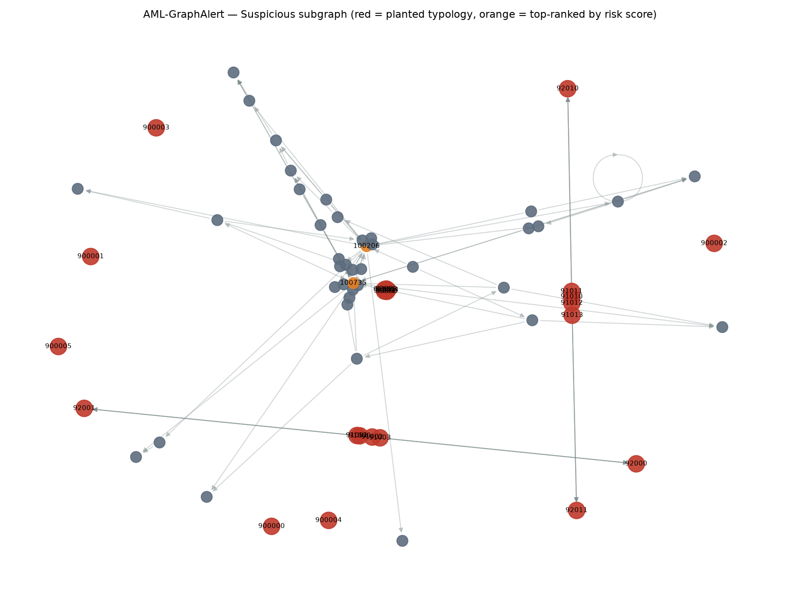

# AML-GraphAlert — Detection of AML Typologies & Transaction Networks

[](https://www.python.org/)
[](sql/README_SQL.md)
[](https://networkx.org/)
[](LICENSE)

[Read the Spanish version](README.es.md)

---

## What it does

Banks and fintechs must detect *unusual transactions* — activity that does
not match a customer's profile or that fits known money-laundering
typologies — and report them. Rule engines alone generate far too many
alerts: most are false positives, and analysts drown in them. This project
combines three layers, in the order a compliance team would actually use
them:

| Layer | Tool | What it catches |
|---|---|---|
| **1. SQL rules** | DuckDB / PostgreSQL (`sql/`) | Structuring, profile deviation, fan-in/fan-out |
| **2. Graph analysis** | NetworkX (`src/graph_analysis.py`) | Closed cycles (round-tripping), mule rings, collector accounts, bridge nodes (PageRank / betweenness) |
| **3. Alert prioritisation** | Isolation Forest (`src/alert_scoring.py`) | Ranks all flagged accounts 0–100 so review starts with the riskiest |

The pipeline is fully reproducible: `python -m src.run_pipeline`
generates the synthetic data, runs the SQL, builds the graph, scores the
alerts and writes everything to `outputs/`.

## Results on the synthetic example — illustrative

> ⚠️ **All numbers below are illustrative.** They are computed on
> synthetic data with planted typologies (seed 42), so they show that the
> pipeline works end-to-end — not how it would perform on real data.
> Precision/recall here are measured against the planted labels, which
> real compliance teams do not have for most alerts.

| Metric | Value |
|---|---|
| Accounts / transactions | 823 / 50,362 (90 days, Jan–Mar 2026) |
| Planted suspicious accounts | 23 (6 structuring, 8 mules, 4 collectors, 5 round-tripping) |
| Accounts with ≥1 rule hit | 25 |
| Rule-hit rows (all rules) | 25 (6 structuring, 8 fan-in/out, 2 profile deviation, 5 cycle, 4 collector) |
| Cycles found (length ≤ 6) | 1 — exactly the planted 5-account cycle |
| Collector accounts detected | 4 — all planted collectors (`CTA-920xx`), each receiving from 4 flagged mules |
| Precision / recall, all rule alerts | **0.920 / 1.000** (23 of 23 planted found) |
| Precision @ top-10 ranked | 1.000 (10/10) |
| Precision @ top-21 ranked | 1.000, recall 0.913 (21/23) |
| Precision @ top-23 ranked | 1.000, recall 1.000 (23/23) |
| Precision @ top-50 ranked | 0.460, recall 1.000 |



The suspicious subgraph (red = planted typology accounts, orange =
top-ranked by risk score) is also available as an interactive page in
`outputs/suspicious_subgraph.html` (open it in a browser).

### How to read the false-positive comparison

Two comparisons, both illustrative:

1. **Rule tuning beat the model.** The first version of the fan-in/out
   rule aggregated over the whole 90 days: 144 hits, and all rule alerts
   together had precision **0.09** / recall 0.609. Changing the rule to a
   *weekly* window (many senders in one week, not in three months) cut
   fan-in/out to **8 hits — all 8 mules** — and all rule alerts to
   precision **0.920** / recall 1.000. The window choice did most of the
   work. Honest caveat: the v2 thresholds were tuned after seeing v1,
   so v2 precision is optimistic; on real data, thresholds must be tuned
   on labelled history, not on the set you measure.
2. **Ranking as triage.** The ML scorer ranks the 23 planted accounts in
   positions 1–23 (top-10 precision 1.000, top-23 precision 1.000).
   Reviewing the top 23 ranked accounts instead of all 823 is a
   **97.2% smaller review queue** at 100% recall of planted accounts.
   The 4 collector accounts rank 12–15 (risk score ≈ 62): they are found
   by the collector rule, which flags accounts receiving SPEI transfers
   from at least 2 already-flagged mule accounts
   (`src/graph_analysis.py: detect_collectors`).

The point is not the exact percentage (it is an artefact of synthetic
data); the point is the *workflow*: rules for explainability and audit,
ML for triage, a human for the final decision. In production the same
comparison must be re-run on labelled history, with thresholds tuned to
the team's capacity and risk appetite.

## Architecture

```
data/synthetic/ ──► SQL rules (DuckDB) ──┐
  accounts.csv      01_structuring.sql   │
  transactions.csv  02_profile_deviation │
  ground_truth.csv  03_fan_in_out.sql    ▼
                     ┌─────────────────────────────────┐
                     │ rule_hits.csv                   │
                     └──────────────┬──────────────────┘
                                    │
  transactions.csv ──► NetworkX graph ──► cycles, fan-in/out,
                                           collectors, PageRank,
                                           betweenness
                                    │
                                    ▼
              IsolationForest + rule evidence
                         │
                         ▼
        outputs/alerts_ranked.csv (risk_score 0–100)
        outputs/metrics.json
        outputs/suspicious_subgraph.html  (interactive, pyvis)
        outputs/suspicious_subgraph.png
```

## How to run

```bash
git clone https://github.com/carlosedurampz-sketch/AML-GraphAlert.git
cd AML-GraphAlert

python3 -m venv .venv
.venv/bin/pip install -r requirements.txt

# Full pipeline (generates data, runs SQL + graph + ML, writes outputs/)
.venv/bin/python -m src.run_pipeline

# …or everything, including tests:
bash run_all.sh
# …or:  make run   /   make test
```

Outputs:

| File | Contents |
|---|---|
| `outputs/alerts_ranked.csv` | One row per account, `risk_score` 0–100, `rank`, rule count, graph features |
| `outputs/rule_hits.csv` | Every SQL/graph rule hit (`account_id, rule, detail`) |
| `outputs/collectors.csv` | Collector accounts: flagged mule senders, amounts received |
| `outputs/cycles.csv` | Closed transfer cycles found |
| `outputs/fan_in_out.csv` | Fan-in/out and pass-through ratio per account |
| `outputs/centrality.csv` | PageRank and betweenness per account |
| `outputs/metrics.json` | Counts, precision/recall (illustrative), FP-reduction comparison |
| `outputs/suspicious_subgraph.html` | Interactive suspicious subgraph (open in a browser) |
| `outputs/suspicious_subgraph.png` | Same subgraph as a static image |

### Tests

```bash
.venv/bin/python -m pytest tests/ -v
```

Tests execute the real structuring SQL in DuckDB and the real graph
functions on toy data (cycle detection, fan-in counting, collector
detection). CI runs the same suite on every push
(`.github/workflows/ci.yml`, Python 3.11 on `ubuntu-latest`).

## Typologies documented

See [`sql/README_SQL.md`](sql/README_SQL.md) for the full documentation
of each rule, its thresholds and its caveats. Summary:

1. **Structuring** (`sql/01_structuring.sql`) — several cash
   deposits of MXN 13,500–14,900 (just below the illustrative MXN 15,000
   threshold) in 24 h–7 d windows, using window functions with a `RANGE`
   time frame.
2. **Profile deviation** (`sql/02_profile_deviation.sql`) — recent 7-day
   activity far above the account's *own* baseline (z-score > 3 or >5×
   mean, with a materiality floor and a minimum-history requirement).
3. **Fan-in / fan-out** (`sql/03_fan_in_out.sql`) — many distinct SPEI
   senders, forwarding ~everything onwards (`pass_through_ratio ≥ 0.70`),
   the classic mule-account shape.
4. **Round-tripping** (graph, not SQL) — closed cycles
   A → B → C → D → E → A with similar amounts, found with
   `networkx.simple_cycles` on strongly connected components.
5. **Collector accounts** (graph, `detect_collectors`) — an account that
   receives SPEI transfers from at least 2 distinct accounts already
   flagged as mules by the fan-in/out rule. Collectors rarely forward
   funds, so the other rules miss them; the mule flags are the evidence
   that points at them. Threshold: `min_distinct_mules = 2`.

Thresholds are modelling choices for this portfolio, **not** statements
of Mexican law (LFPIORPI / CNBV / UIF rules set their own). See
`sql/README_SQL.md` before reusing any number.

## Methodology

- **Synthetic data, labelled by construction.** Real AML data is
  confidential, so the generator (`src/generate_synthetic.py`, seed 42)
  creates ~800 normal accounts (payroll, SPEI, ATM, card) and plants
  23 suspicious ones across the typologies above + a cycle. Labels are
  used *only* for evaluation, never to train the scorer — the
  Isolation Forest is unsupervised, as in a real setting where confirmed
  cases are rare.
- **No temporal leakage in the rules.** The profile-deviation baseline
  excludes the recent window it is compared against; the structuring
  windows slide in time.
- **Explainability over black boxes.** Every alert keeps its rule
  (`detail` column) and its graph features, so an analyst can say *why*
  an account was flagged. The ML score only orders the queue.
- **Reproducibility.** Fixed seed, pinned requirements, one command
  (`bash run_all.sh`) from a clean checkout to all outputs.

## Limitations

- Synthetic data is cleaner than real data: typologies are planted, so
  precision/recall are optimistic and not comparable to production.
  The v2 rule thresholds were also tuned after seeing the v1 results.
- The graph is built from SPEI transfers only; cash has no counterparty.
- Betweenness is sampled (100 pivots) for speed; PageRank is exact.
- Cycle detection on large graphs searches only aggregated edges
  ≥ MXN 10,000 (see `src/graph_analysis.py`): random low-value traffic
  creates countless spurious short cycles, and a round-tripping ring
  moves large repeated amounts. Small-value cycles would be missed.
- The collector rule depends on the mule rule: if a mule is not flagged
  by fan-in/out, it cannot point at its collector either.
- Accounts that only appear as a counterparty (such as collectors) have
  no transaction-side behavioural features; they are scored on their
  rule evidence and graph features.
- The scorer is unsupervised — with real labelled cases, a supervised
  model and calibration would be the next step.
- This is a portfolio project, not a compliance system: it does not
  implement reporting, case management, or any legal advice.

## Project structure

```
AML-GraphAlert/
├── README.md / README.es.md
├── LICENSE (MIT)
├── requirements.txt
├── Makefile / run_all.sh
├── .github/workflows/ci.yml
├── docs/images/
│   └── suspicious_subgraph.png
├── sql/
│   ├── 01_structuring.sql
│   ├── 02_profile_deviation.sql
│   ├── 03_fan_in_out.sql
│   └── README_SQL.md
├── src/
│   ├── generate_synthetic.py   # SPEI + cash generator, planted typologies
│   ├── graph_analysis.py       # NetworkX: cycles, fan-in/out, collectors, centrality
│   ├── alert_scoring.py        # IsolationForest prioritisation + evaluation
│   ├── visualize.py            # pyvis interactive subgraph + PNG
│   └── run_pipeline.py         # end-to-end orchestration
├── tests/
│   ├── test_structuring.py     # real SQL in DuckDB
│   ├── test_graph.py           # cycle + fan-in detection
│   └── test_collector.py       # collector rule, positive + negative cases
├── data/synthetic/             # generated (git-ignored)
└── outputs/                    # generated (git-ignored)
```

## Author & License

Built by **Carlos Eduardo Ramírez Pérez** — Physicist (UAM) focused on quantitative modeling, risk analytics, and data science. Licensed under the MIT License.
